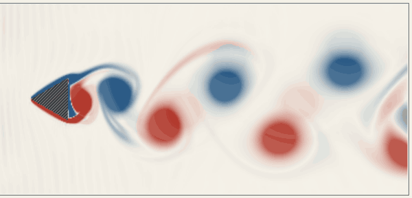
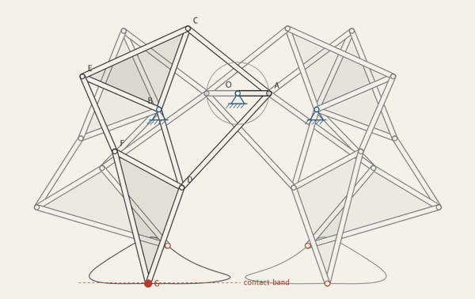
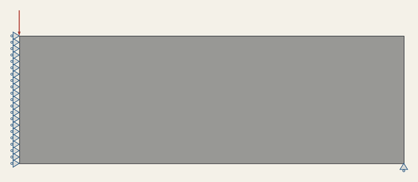
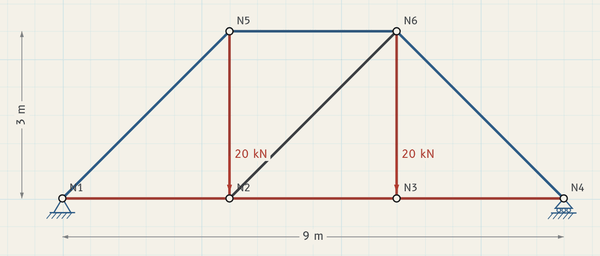

# Vellum

A collection of mechanical engineering tools I built while taking my engineering classes.

<table>
  <tr>
    <td width="50%"><br><sub>04 Wind tunnel</sub></td>
    <td width="50%"><br><sub>07 Linkage simulator</sub></td>
  </tr>
  <tr>
    <td width="50%"><br><sub>03 Topology optimizer</sub></td>
    <td width="50%"><br><sub>01 Frame and truss solver</sub></td>
  </tr>
</table>

**[▶ Live site](https://kenchollacoop2005.github.io/Vellum/)** · [The sheets](#the-sheets) · [How it works](#how-it-works)

## Why

Most of what I learn in class gets solved once on paper and then put away. I wanted to actually play with it: move a support and watch the forces change, paint material onto a beam and let an optimizer carve it back out, or hear what the vibration modes of a spring and mass system sound like. So I started building small tools for the topics I found interesting, and they ended up in one place.

The name comes from drafting vellum, the film engineers drew on before CAD. Each tool is laid out like one sheet in a drawing set, with a title block in the corner.

## The sheets

| Sheet | What it does |
|---|---|
| [01 Frame and truss solver](https://kenchollacoop2005.github.io/Vellum/sheets/01-frame/) | Draw a structure, load it, see member forces, reactions and the deflected shape. |
| [02 Beam diagrams and Mohr's circle](https://kenchollacoop2005.github.io/Vellum/sheets/02-beam-mohr/) | Shear, moment and deflection diagrams for a beam, plus plane stress transformation. |
| [03 Topology optimizer](https://kenchollacoop2005.github.io/Vellum/sheets/03-topology/) | Watch an optimizer remove material until only the structure that matters is left. |
| [04 Wind tunnel](https://kenchollacoop2005.github.io/Vellum/sheets/04-wind-tunnel/) | 2D flow around a shape, with drag, lift and vortex shedding. |
| [05 Laminate calculator](https://kenchollacoop2005.github.io/Vellum/sheets/05-laminate/) | Stiffness and first ply failure of a composite layup. |
| [06 Vibrations you can hear](https://kenchollacoop2005.github.io/Vellum/sheets/06-vibrations/) | Mass and spring chains, mode shapes, and the natural frequencies played as tones. |
| [07 Linkage simulator](https://kenchollacoop2005.github.io/Vellum/sheets/07-linkage/) | Four bar linkages and Theo Jansen's Strandbeest leg. |
| [V Verification](https://kenchollacoop2005.github.io/Vellum/verify.html) | The checks behind every sheet, run in your browser. |

## Checking the math

Since these are engineering tools, I wanted them to be right, not just look right. Each sheet is compared against textbook answers, hand calculations or published benchmarks, and the Verification sheet reruns those comparisons in your browser. The same cases run as tests with `npm test`.

<details>
<summary><b>A few of the benchmarks</b></summary>

| Benchmark | Expected | Computed |
|---|---|---|
| MBB beam 60 × 20, top88 settings, compliance | 203.19 (94 iterations) | 203.1925 (94 iterations) |
| Schäfer and Turek 2D-1 cylinder, drag coefficient | 5.5795 (pass band 5.5 to 5.8) | 5.645 at 20 cells per diameter |
| Quasi isotropic [0/45/−45/90]s T300/5208, Ex | 69.676 GPa | 69.676 GPa |
| Three equal masses fixed fixed, ω1, ω2, ω3 | 24.203, 44.721, 58.431 rad/s | 24.203, 44.721, 58.431 rad/s |

</details>

## How it works

<details>
<summary><b>Each sheet in a few sentences</b></summary>

**Frame and truss solver.** Direct stiffness method with 2D truss and Euler Bernoulli frame elements. Nodes are renumbered with reverse Cuthill McKee and the system is solved with a banded Cholesky factorization, which also catches mechanisms.

**Beam and Mohr's circle.** A fine finite element mesh gives exact reactions, even for indeterminate beams. Shear and moment then come from statics, so the diagrams are exact for point loads, moments and linear distributed loads.

**Topology optimizer.** A line by line JavaScript port of the 88 line MATLAB code by Andreassen et al. (modified SIMP, optimality criteria, sensitivity or density filter), running in a Web Worker. Results export as an STL you can print, or an SVG.

**Wind tunnel.** D2Q9 lattice Boltzmann with TRT collision, a Zou and He inlet, a fixed density outflow and interpolated bounce back on curved shapes. Drag and lift come from momentum exchange. It's a 2D, low Reynolds number model for building intuition, not real CFD.

**Laminate calculator.** Classical laminate theory: Q, Q̄, A, B and D, effective moduli, a polar plot of Ex, and first ply failure by max stress and Tsai Wu.

**Vibrations.** Generalized eigenproblem K φ = ω² M φ with mass normalized modes, frequency response, and free response by Newmark time stepping. The tones are all shifted by one factor into hearing range, so the intervals between modes stay exact.

**Linkage simulator.** Joints are found by two circle intersections. A crank turns all the way around; a rocker swings between its limits and switches assembly at each one, so the full coupler curve traces in one continuous motion. The Jansen leg uses his "holy numbers."

</details>

<details>
<summary><b>Running locally</b></summary>

Plain HTML, CSS and JavaScript modules, no build step. Serve the folder with any static server:

```bash
npx serve .
```

or open it with VS Code Live Preview. Opening `index.html` straight from disk won't work, because browsers block modules and workers on `file://`.

Tests use Node's built in runner (Node 20 or newer). `npm run test:slow` adds the two flow benchmarks, which take a few minutes.

```bash
npm test
```

</details>

<details>
<summary><b>Project layout</b></summary>

```
index.html            cover sheet
verify.html           verification sheet
sheets/NN-name/       one folder per sheet: index.html, model.js (math), ui.js, plus worker.js or audio.js
core/                 linear algebra, finite elements, drawing, units, URL state, page shell
verify/               cases.js (every benchmark), run.js, worker and page scripts
css/                  design tokens and layout
fonts/                Routed Gothic and B612 with their licenses
docs/references.md    sources for every method
tests/                node --test files
tools/screens.mjs     screenshot script
media/                screenshots and thumbnails
```

</details>

## Credits

- Routed Gothic by Darren Embry and B612 by the B612 Project (Airbus, Intactile Design), both under the SIL Open Font License 1.1.
- Methods and benchmark data are listed in [docs/references.md](docs/references.md).

## License

MIT. See [LICENSE](LICENSE).

## Author

**Ken Chollacoop** · [GitHub](https://github.com/KenChollacoop2005) · [Portfolio](https://kenchollacoop2005.github.io/Bulletin/)
