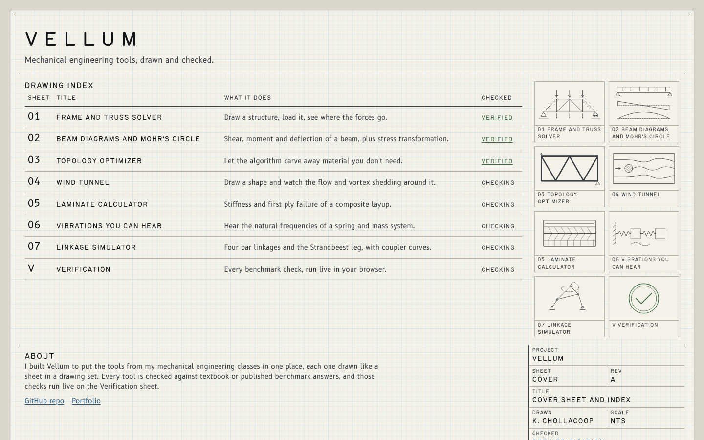

# Vellum

Seven mechanical engineering tools in the browser, drawn like sheets in a drawing set and checked against known answers.

<p align="center"></p>

**Live:** https://kenchollacoop2005.github.io/Vellum/

## The sheets

| Sheet | What it does |
|---|---|
| [01 Frame and truss solver](https://kenchollacoop2005.github.io/Vellum/sheets/01-frame/) | Draw a structure, load it, see member forces, reactions and the deflected shape. |
| [02 Beam diagrams and Mohr's circle](https://kenchollacoop2005.github.io/Vellum/sheets/02-beam-mohr/) | Shear, moment and deflection diagrams for a beam, plus plane stress transformation. |
| [03 Topology optimizer](https://kenchollacoop2005.github.io/Vellum/sheets/03-topology/) | Minimum compliance SIMP optimization, a port of the 88 line code, live. |
| [04 Wind tunnel](https://kenchollacoop2005.github.io/Vellum/sheets/04-wind-tunnel/) | 2D lattice Boltzmann flow around a shape, with drag, lift and vortex shedding. |
| [05 Laminate calculator](https://kenchollacoop2005.github.io/Vellum/sheets/05-laminate/) | Classical laminate theory, ABD matrices and first ply failure. |
| [06 Vibrations you can hear](https://kenchollacoop2005.github.io/Vellum/sheets/06-vibrations/) | Mass and spring chains, mode shapes, frequency response, and the modes played as tones. |
| [07 Linkage simulator](https://kenchollacoop2005.github.io/Vellum/sheets/07-linkage/) | Four bar linkages and the Jansen Strandbeest leg with coupler curves. |
| [V Verification](https://kenchollacoop2005.github.io/Vellum/verify.html) | Every benchmark check, run in your browser. |

## How it's checked

Every sheet has a list of benchmark cases in `verify/cases.js`: textbook answers, hand calculations and published benchmarks. The same file drives the Node tests (`npm test`) and the Verification sheet, which runs the checks in your browser and shows a CHECKED stamp when all of them pass. A few headline results from the test run:

| Benchmark | Expected | Computed |
|---|---|---|
| MBB beam 60 × 20, top88 settings, compliance | 203.19 (94 iterations) | 203.1925 (94 iterations) |
| Schäfer and Turek 2D-1 cylinder, drag coefficient | 5.5795 (pass band 5.5 to 5.8) | 5.645 at 20 cells per diameter, inlet speed 0.05 |
| Quasi isotropic [0/45/−45/90]s T300/5208, Ex | 69.676 GPa | 69.676 GPa |
| Three equal masses fixed fixed, ω1, ω2, ω3 | 24.203, 44.721, 58.431 rad/s | 24.203, 44.721, 58.431 rad/s |

<details>
<summary><b>How it works</b></summary>

**Frame and truss solver.** Direct stiffness method with 2D truss and Euler Bernoulli frame elements. Nodes are renumbered with reverse Cuthill McKee and the system is solved with a banded Cholesky factorization, which also catches mechanisms.

**Beam and Mohr's circle.** A fine finite element mesh with consistent loads gives exact reactions, even for indeterminate beams. Shear and moment then come from statics, so the diagrams are exact for point loads, moments and linear distributed loads. Mohr's circle plots τ positive downward.

**Topology optimizer.** A line by line JavaScript port of top88.m (modified SIMP, optimality criteria, sensitivity or density filter) running in a Web Worker with a banded solver. Exports a watertight STL and an SVG outline.

**Wind tunnel.** D2Q9 lattice Boltzmann with TRT collision, a Zou and He inlet, a fixed density outflow and interpolated bounce back on curved shapes. Drag and lift come from momentum exchange. The benchmark ran at a peak lattice inlet speed of 0.05 with 20 cells per diameter, and the sheet uses the same 0.05 by default; a faster 0.1 setting is labeled as lower accuracy. It is a 2D, low Reynolds number model for intuition, not real CFD.

**Laminate calculator.** Classical laminate theory: Q, Q̄, A, B and D, effective moduli from A inverse, a polar plot of Ex, and first ply failure by max stress and Tsai Wu.

**Vibrations.** Generalized eigenproblem K φ = ω² M φ with mass normalized modes, an exact complex frequency response, Newmark time stepping for free response, and Web Audio tones shifted by one factor so the intervals between modes stay exact.

**Linkage simulator.** Joints found by two circle intersections on a fixed branch, with Grashof class, transmission angle, toggle positions and dead zones. The Jansen leg uses the holy numbers and is cross checked with a Newton solve of all bar equations.

</details>

<details>
<summary><b>Running locally</b></summary>

It is plain HTML, CSS and JavaScript modules with no build step. Serve the folder with any static server:

```bash
npx serve .
```

or open it with VS Code Live Preview. Opening `index.html` straight from disk won't work because browsers block modules and workers on `file://`.

Tests use Node's built in runner (Node 20 or newer):

```bash
npm test
```

```bash
npm run test:slow
```

The slow run adds the two flow benchmarks, which take a few minutes. `npm run screens` captures every page with Playwright (dev only).

</details>

<details>
<summary><b>Project layout</b></summary>

```
index.html            cover sheet
verify.html           verification sheet
sheets/NN-name/       one folder per sheet: index.html, model.js (math), ui.js, plus worker.js or audio.js
core/                 linear algebra, finite elements, drawing, units, URL state, page shell
verify/               cases.js (every benchmark), run.js, worker and page scripts
css/                  design tokens and layout
fonts/                Routed Gothic and B612 with their licenses
docs/references.md    sources for every method
tests/                node --test files
tools/screens.mjs     screenshot script
media/                screenshots and thumbnails
```

</details>

## Credits

- Routed Gothic by Darren Embry, SIL Open Font License 1.1 (`fonts/RoutedGothic-OFL.txt`).
- B612 by the B612 Project (Airbus, Intactile Design), SIL Open Font License 1.1 (`fonts/B612-OFL.txt`).
- Methods and benchmark data: see [docs/references.md](docs/references.md). The topology optimizer follows Andreassen et al. (2011); the flow benchmark is Schäfer and Turek (1996).

## License

MIT. See [LICENSE](LICENSE).

## Author

**Ken Chollacoop** · [GitHub](https://github.com/KenChollacoop2005) · [Portfolio](https://kenchollacoop2005.github.io/Bulletin/)
